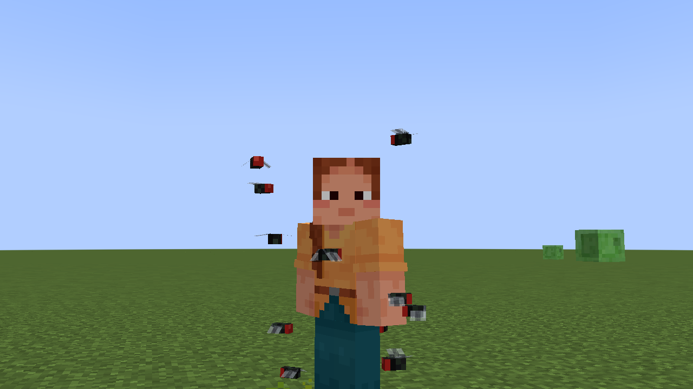
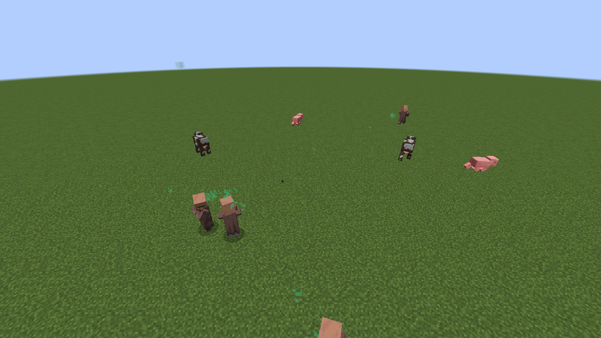
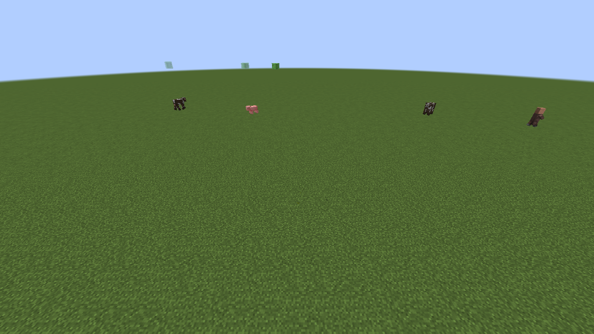
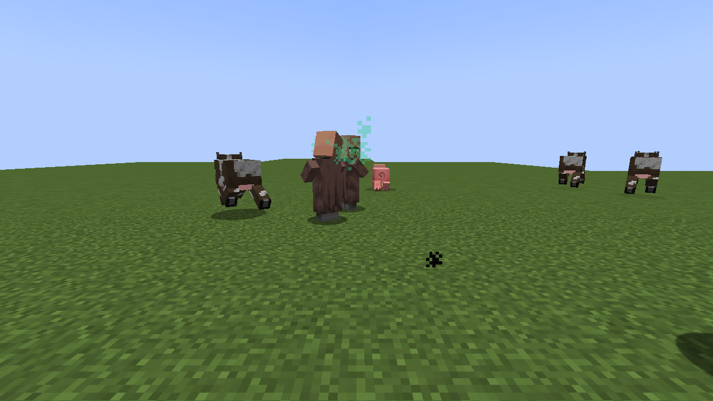
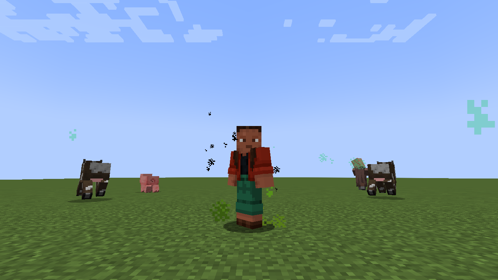

# Hygiène

Mod Fabric pour Minecraft 1.21 – 1.21.1. Les joueurs qui ne se lavent pas finissent par **puer**, et tout le monde le leur fait sentir : mouches, animaux qui s'enfuient, villageois dégoûtés qui rentrent chez eux en courant et qui font payer plus cher.



## Saleté

Chaque joueur a une jauge de saleté de 0 à 100 %.

| Ça salit | Ça lave |
|---|---|
| Le temps qui passe : 100 % en 50 minutes | Être dans l'eau |
| Courir : deux fois plus vite | Être sous l'eau : lavage complet en quelques secondes |
| Miner, combattre | La pluie, lentement |

La crasse survit à la mort : on ne se lave pas en mourant.

## Stades

| Stade | Saleté | Ce qui se passe |
|---|---|---|
| Propre | 0 – 25 % | Rien |
| Odeur | 25 – 50 % | Quelques mouches. Les villageois proches secouent la tête. Prix **+20 %** |
| Puant | 50 – 75 % | Nuée de mouches, bourdonnement, nuage vert. Les animaux et les villageois **s'enfuient** en éternuant. Prix **+50 %** |
| Infect | 75 – 100 % | Les villageois **rentrent chez eux en courant** et **refusent tout échange** (« Va te laver avant de revenir ! »). Les joueurs collés à toi ont **la nausée** |

À chaque changement de stade, un message s'affiche dans la barre d'action. Les villageois commentent aussi ton passage (« Quelqu'un vient de claquer sa porte. »).

| Avant | 5 secondes plus tard |
|---|---|
|  |  |

Le joueur sale ne voit que quelques mouches à distance, pour garder l'écran dégagé :



## Mouches en 3D

Les joueurs qui ont le mod installé voient un **essaim de mouches en 3D** autour des joueurs sales : corps noir, gros yeux rouges, ailes translucides qui battent, vol en zigzag. Plus le joueur est sale, plus l'essaim est gros (2, 6 puis 14 mouches).

Les joueurs qui n'ont pas le mod voient des mouches en particules à la place :



## Commande

| Commande | Effet |
|---|---|
| `/hygiene` | Affiche ta saleté |
| `/hygiene <joueur>` | Affiche celle d'un autre joueur (op) |
| `/hygiene set <joueur> <0-100>` | Règle la saleté d'un joueur (op) |

## Installation

1. Installer [Fabric Loader](https://fabricmc.net/use/) pour Minecraft 1.21 ou 1.21.1.
2. Mettre [Fabric API](https://modrinth.com/mod/fabric-api) et le jar des [Releases](https://github.com/luuuccasss/hygiene/releases) dans le dossier `mods/`.

Le mod s'installe **sur le serveur**. Côté joueurs, il est **facultatif** :

- **sans le mod**, ils peuvent se connecter avec un Minecraft normal et tout fonctionne, avec des mouches en particules ;
- **avec le mod**, ils voient en plus les mouches en 3D.

Il marche aussi en solo.

## Compiler

```sh
./gradlew build
```

Le jar se trouve dans `build/libs/`. Les vitesses de saleté et de lavage se règlent en haut de `Hygiene.java`, les seuils et les effets dans `Stage.java`.

## Licence

MIT
